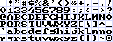
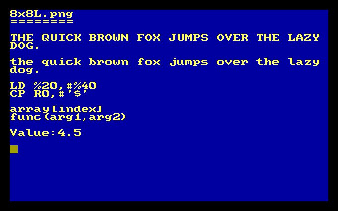
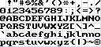

# 8x8 Pixel Bitmap Fonts

These fonts are meant for retro computers like the [JU+TE computer](https://github.com/boert/JU-TE-Computer) (east german 8-bit computer from the end of the 80s) or games.

Each font is defined in a plain bitmap:

and can be converted to binary data with the [Lisette](https://github.com/ivov/lisette) application at [src/main.lis](src/main.lis).
Each "dark" color will be treated as `1` and each "light" color as `0`.
The light-blue lines (also converted to `0`) are just visual guides to mark pixels that should remain empty to prevent neighboring characters from touching.

The fonts take inspiration from several retro fonts.

## Example

## TTF

Those who want to use it on a PC, may use the service at https://yal.cc/tools/pixel-font/ to convert it to a TTF font.
This better is done with the following base image with two additional pixels for descents in letters like `fgpq` (`,;:` have also been modified):

## Design decisions
Following design decisions were tried to follow more or less (depending on the font variant):
- each character should be intuitively distinguishable from similar ones, e.g. `0` and `O`; `1`, `i` and `l`; `;` and `j`; `U` and `V`; `c` and `o`
- small letters should use the same upper "base line"
- typical prefix-characters can be less bold than digit or letters to make numbers, keywords or identifiers stand more out, e.g. `ld r0, #%40`
- braces and brackets are shifted to the right (opening) or left (closing) to make them look better in normal situations, e.g. `foo(bar)` or `array[index]`
- characters which usually are followed by a space - colon, semicolon, dot, comma - are shifted to the left
- most of the characters have serifs making longer texts a little bit easier to read
- characters in neighboring rows ideally should not touch each other
